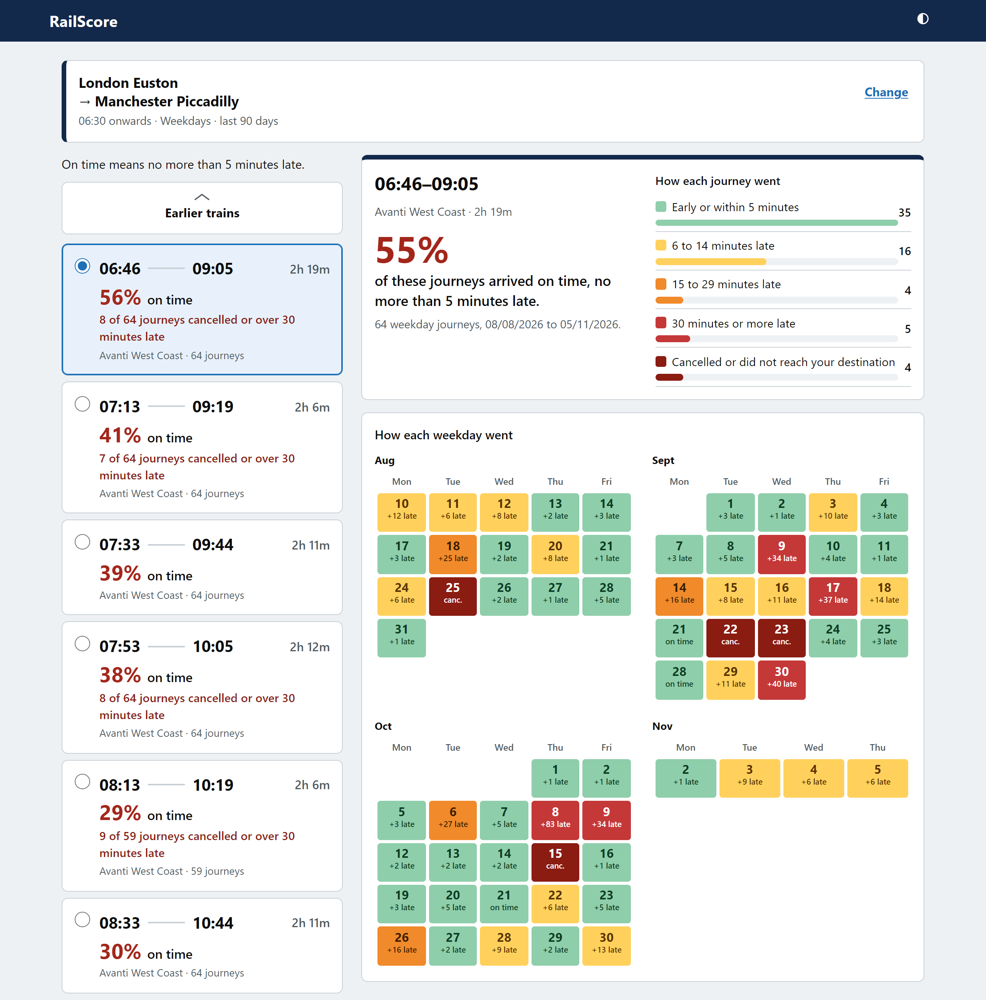
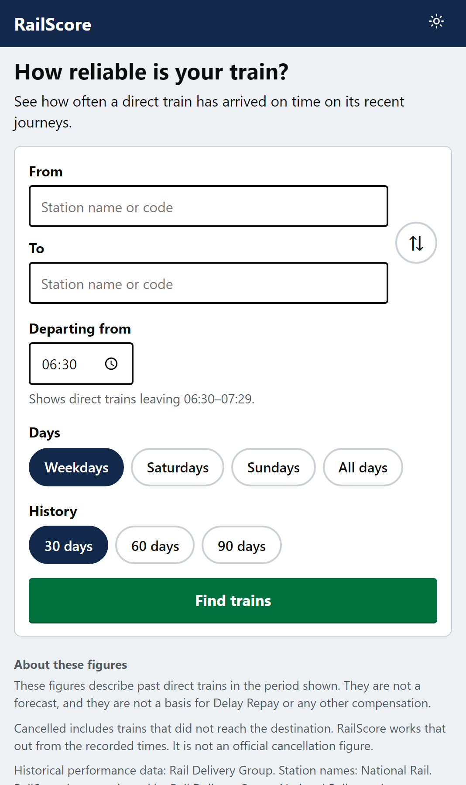
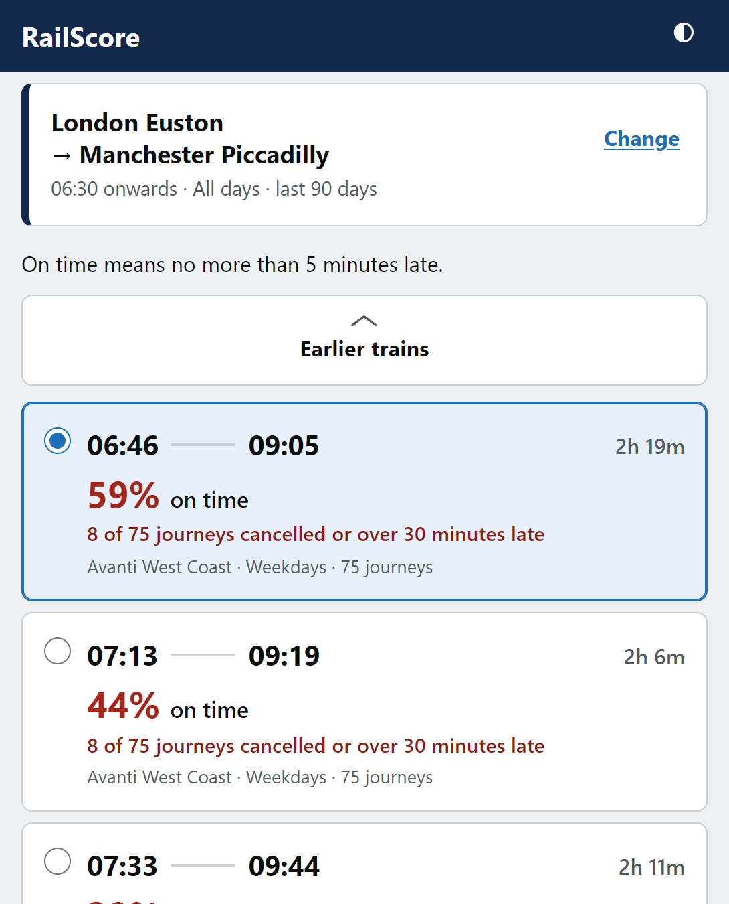
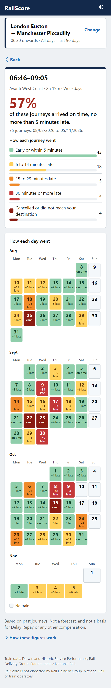

# RailScore

**[Live demo](https://rail-score.vercel.app)**

RailScore shows how a direct UK train has performed on its recent runs: arrivals within 5 minutes, cancellations, and a delay distribution. It is not a journey planner. Journeys with a change are out of scope. There is no single score.



On a phone: search, trains, arrival history.

<table>
  <tr>
    <td></td>
    <td></td>
    <td></td>
  </tr>
</table>

**Stack:** TypeScript, Next.js, PostgreSQL (Neon), Vitest, deployed on Vercel.

**Highlights**

- Punctuality rules live in `packages/core`, a TypeScript package with no framework or database, covered by unit tests.
- A scheduled import of the Darwin Push Port feed (Kafka) into Postgres, so a search and a calculation are a few database reads with no call to an outside API. Days before the import began are filled from HSP after the page is shown, and stored.
- Train lists start from today's Darwin timetable and pool each train's past runs by schedule UID.
- Runs on free tiers only: Vercel Hobby, Neon Free (1 GB per project: a year of the whole network, packed into month rows), and cron-job.org.

Built with AI-assisted development (Cursor, Claude Code).

How it is built is in [docs/architecture.md](docs/architecture.md), the classification and counting rules in [docs/data-rules.md](docs/data-rules.md), and the main decisions in [docs/adr/](docs/adr/).

## Data

Train performance is from Darwin Real Time Train Information (the Push Port, read over Kafka, and its hourly snapshots) on the Rail Data Marketplace. Station names and CRS codes are from the [Knowledgebase Stations data feed](https://raildata.org.uk/dashboard/dataProduct/P-88ffe920-471c-4fd9-8e0d-95d5b9b7a257/overview).

Darwin history starts on the first day the import saw whole, 4 November 2026 (`DARWIN_FIRST_DAY`), and reaches back at most `DARWIN_KEEP_DAYS` (365). The days of a period of up to 90 days before that come from [Historic Service Performance](https://raildata.org.uk) (HSP) on the Rail Data Marketplace, asked after the page is shown and stored (see [architecture](docs/architecture.md#days-before-darwin-hsp)). Without HSP, and for 180 and 365 days, the list names the days it covers. If the import stops, no new runs arrive.

Credit the data publisher when showing this data. This project is not approved by, and is not affiliated with, the publisher or the Rail Data Marketplace.

Both feeds need your own marketplace credentials. None are included here.

## Install

Requires Node.js 22 or newer, and npm. The root `package.json` records that range.

```bash
npm install
```

Copy `.env.example` to `apps/web/.env.local` and replace the placeholders. Next.js and `npm run db:migrate` read that file. The example at the repository root is not loaded by itself. The server reads the variables in `apps/web/server/env.ts`. If a required one is missing, the error names it. `apps/web/.env.local` is ignored by Git. Do not commit it.

Every variable is server-only. Do not add a `NEXT_PUBLIC_` prefix.

| Variable                                              | Role                                                                                                                                                                                                                      |
| ----------------------------------------------------- | ------------------------------------------------------------------------------------------------------------------------------------------------------------------------------------------------------------------------- |
| `STATIONS_BASE_URL`, `STATIONS_API_KEY`               | Station names and CRS codes. Required, including when `RAILSCORE_DATA=mock`. The server sends the key as `x-apikey`.                                                                                                      |
| `DATABASE_URL`                                        | Postgres holding the Darwin runs. Required for live data; without it no train is listed. The running app should use a pooled URL. `npm run db:migrate` should use the direct URL.                                         |
| `DATABASE_POOL_MAX`                                   | Optional. Postgres connections in this process. Default 3.                                                                                                                                                                |
| `RAILSCORE_DATA`                                      | Leave unset for the live feed. `mock` serves made-up trains.                                                                                                                                                              |
| `PORT`                                                | Optional. `npm run dev` uses 3000.                                                                                                                                                                                        |
| `DARWIN_KAFKA_*`                                      | Darwin Push Port on Kafka, for the import below. Required for live data. Bootstrap, topic, group, username and password, as the Rail Data Marketplace Pub/Sub tab shows them. The import always uses SASL PLAIN over SSL. |
| `DARWIN_SNAPSHOT_URL`, `DARWIN_SNAPSHOT_CONSUMER_KEY` | Hourly Darwin snapshots, read for each day's timetable and when Kafka dropped messages. Required for live data.                                                                                                           |
| `DARWIN_KEEP_DAYS`                                    | Optional. Days of Darwin runs kept. Default 365.                                                                                                                                                                          |
| `DARWIN_FIRST_DAY`                                    | Optional. First day the Darwin import saw whole, `YYYY-MM-DD`. Default `2026-11-04`. Earlier stored days are not counted.                                                                                                 |
| `HSP_BASE_URL`, `HSP_API_KEY_HEADER`, `HSP_API_KEY`   | Optional. Historic Service Performance, for the days of a period before `DARWIN_FIRST_DAY`. Without them the period starts at that day.                                                                                   |
| `HSP_DAILY_CALL_LIMIT`                                | Optional. HSP calls a day across every visitor. Default 5000. Past it the figures are Darwin's alone until midnight.                                                                                                      |
| `CRON_SECRET`                                         | Optional. Turns on `/api/import/darwin`, which needs `Authorization: Bearer <CRON_SECRET>`.                                                                                                                               |

Create the tables when `DATABASE_URL` is set. Point that command at the direct URL, then point the running app at the pooled URL.

```bash
npm run db:migrate
```

## Use

```bash
npm run dev
```

Open <http://localhost:3000>. Choose two stations, a departing-after time, the days, and 30, 60, 90, 180 or 365 days. The defaults before a search are 06:30, weekdays, and 30 days. **Find trains** loads the list. Pick one service and press **Calculate reliability**.

Leave `RAILSCORE_DATA` unset for live trains from the stored Darwin runs. Set it to `mock` for made-up trains, with no database. The station list is still the live feed in both cases.

The same choices are the URL query: `from`, `to`, `time`, `days` (`weekdays`, `saturday`, `sunday`, `all`), `period` (`30`, `60`, `90`, `180`, `365`), `service`, and `calculate=1`.

```bash
npm test
npm run build -w @railscore/web
```

Formatting is `npm run format`. `npm run lint` runs ESLint with Next's rules, React hooks included. `npm run knip` lists unused files, exports and dependencies. CI runs all three.

## Deployment

Any Node host, including a serverless one, can run the production build. Node.js 22 or newer.

From the repository root:

```bash
npm install
npm run build -w @railscore/web
```

`npm run build` is not defined at the repository root. It is defined in `apps/web`. From that directory, `npm run build` is the same Next.js build.

After the build, from the repository root:

```bash
npm start
```

That serves the production build. `PORT` overrides 3000. `npm run dev` is the development server, not this command.

Set the variables from the table above in the host's environment. They stay on the server. For Postgres, give the app the pooled URL and run `npm run db:migrate` once with the direct URL.

On a host whose filesystem is read-only, the station file under `apps/web/.data/` is not kept. The list stays in the memory of that process and is fetched again when the process is new.

Postgres holds every run, so instances share nothing else. A search and a calculation each finish in one request.

### Darwin import

Kafka keeps about an hour of messages, so a scheduler calls `/api/import/darwin` every 15 minutes. The deployment uses [cron-job.org](https://cron-job.org) (free); [ADR 3](docs/adr/0003-cron-job-org-every-15-minutes.md) says why.

1. Set `CRON_SECRET` (a long random string) and the `DARWIN_*` variables in the deployment, then redeploy.
2. On cron-job.org, create a job for `https://<deployment>/api/import/darwin`, every 15 minutes, method GET.
3. Under Advanced, add the header `Authorization` with the value `Bearer <CRON_SECRET>`.
4. Turn on failure notifications, so a run of failures reaches you by email.

The route answers `202` at once and imports after the response. The result is in the deployment's log under `[darwin-import]`. `?wait=1` imports first and answers with the result, for a run by hand. Do not run the import from a machine that shares the production `DARWIN_KAFKA_GROUP`: production would miss those messages.

After a release whose notes ask for it, run the one-off data fix once against each database, with the direct URL:

```bash
npm run db:fold-calls -w @railscore/web -- --write
```

Without `--write` it only counts the rows it would change.

## Licence

[MIT](LICENSE).
